# [Modulation Identification] Cognitive Radio Spectrum Sharing Signal Modulation Classifier Based on CNN [with Report + Codes]

The Electromagnetic (EM) spectrum for radio communication ranges from 30 MHz to 300 GHz. However, a significant portion of wireless communication occurs below 6 GHz, supporting wide coverage, deep indoor penetration, and high data rates. Despite this, the usage rate for frequencies below 6 GHz is only about 10% to 20%, indicating a very low utilization [2]
Spectrum reconfiguration and millimeter wave technology are two suggested solutions to meet the growing demand for wider bandwidth and higher data rates. Spectrum reconfiguration involves reassigning spectrum licenses, which is very complex, while millimeter wave technology has not been fully developed. The potential for sharing spectrum in the <6 GHz band represents an important opportunity to more effectively use spectrum to meet the growing demands for mobile connectivity.
The goal of this project is to comprehensively and simply understand the role of deep learning in future cognitive radio networks that utilize shared spectrum to achieve high spectral efficiency:
·Comprehensive review of existing spectrum sharing and perception technologies.
·Development of a signal modulation classification system based on CNN.
·Development of a deep learning processor (DLP) for custom deep learning networks and assess implementation and time costs.
Methods We used MATLAB for deep learning and deep learning HDL programming to develop a signal modulation classification system based on CNN, as shown in Figure 1. We trained four CNN networks to study how filter size affects classification accuracy. The summary of model parameters is presented in Table 1. Finally, we created a deep learning processor IP block for Xilinx MPSoC boards (see Figure 2), and evaluated the model's resource utilization.
Figure 1: Advanced System Architecture
Conclusions·Experiments have confirmed that CNNs are effective for radio signal modulation classification (see Figure 4).
·Our research revealed a negative correlation between the sensitivity of the CNNS and classification accuracy: increasing sensitivity leads to worse results, as shown in Figure 3.
Figure 3: Model Accuracy vs. Sensitivity Field
· The best-performing model achieved a classification accuracy of 91.8% and was optimized for Xilinx Zynq Ultrascale+ MPSoC, meeting all timing constraints at 100 MHz clock speeds. Vivado implementation and timing report summary are presented in Table 2.
Figure 4: Best Model Performance on the Test Set - 91.8%
Conclusion and Future Work: The potential for greatly improving the current underutilization of most radio spectrum is shared. Applications of CNNs in spectrum perception and signal classification have been proven feasible and offer opportunities to further improve model accuracy, resource utilization, and classification speed (latency).
References [1] J. Manyika and C. Roxburgh. The Great Transformer: The Impact of the Internet on Economic Growth and Prosperity. McKinsey Global Institute, 2011.
[2] S. Shi et al. Challenges and New Directions in Securing Spectrum Access Systems. IEEE Internet of Things Journal, 8, March 2021.
MATLAB Simulation Results Display

## Images

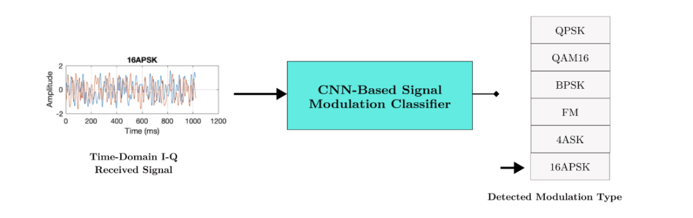
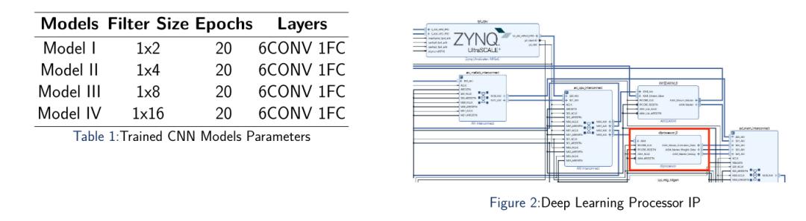
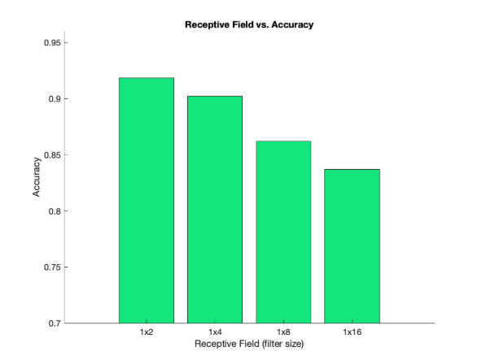
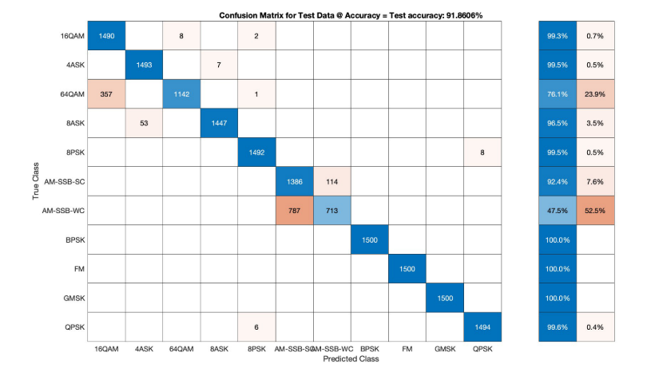
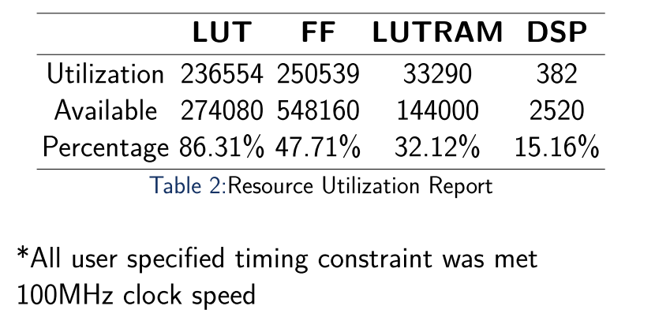
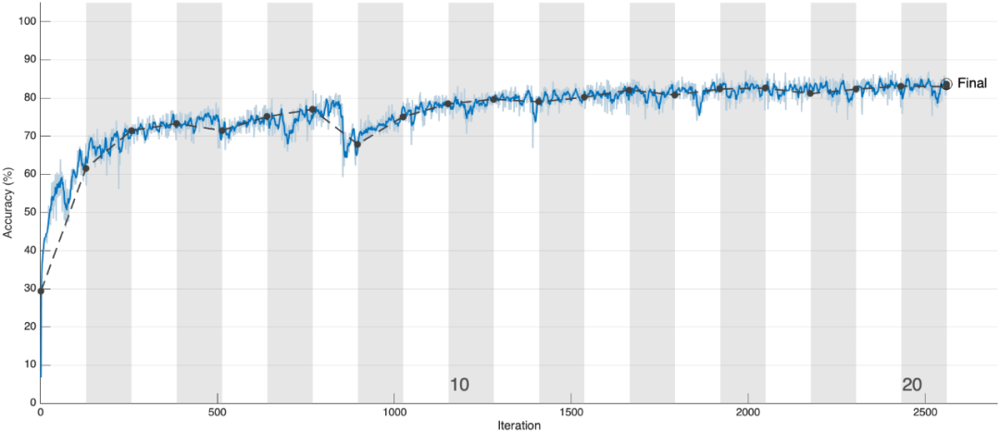
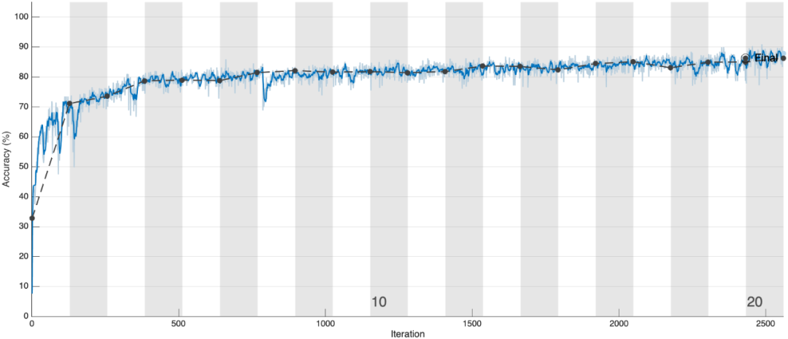
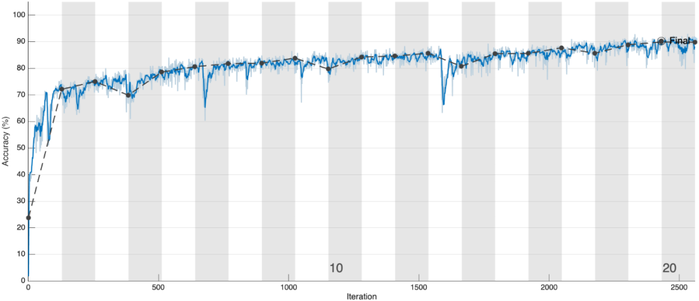
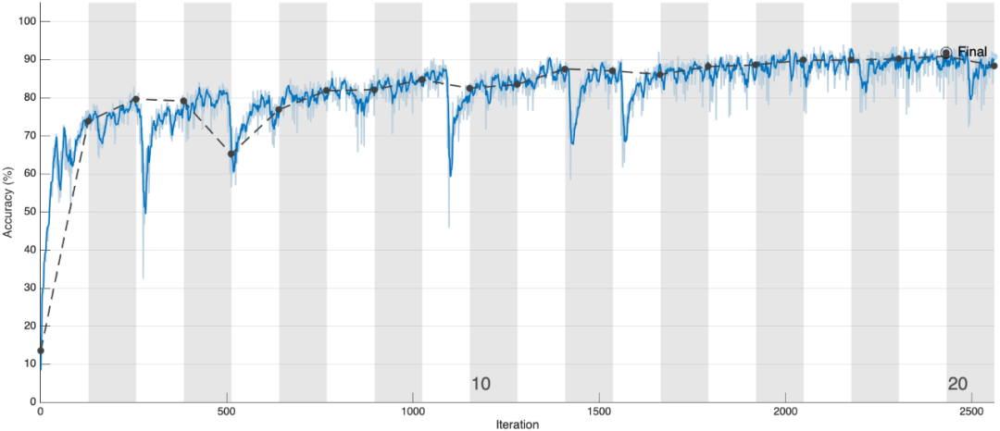
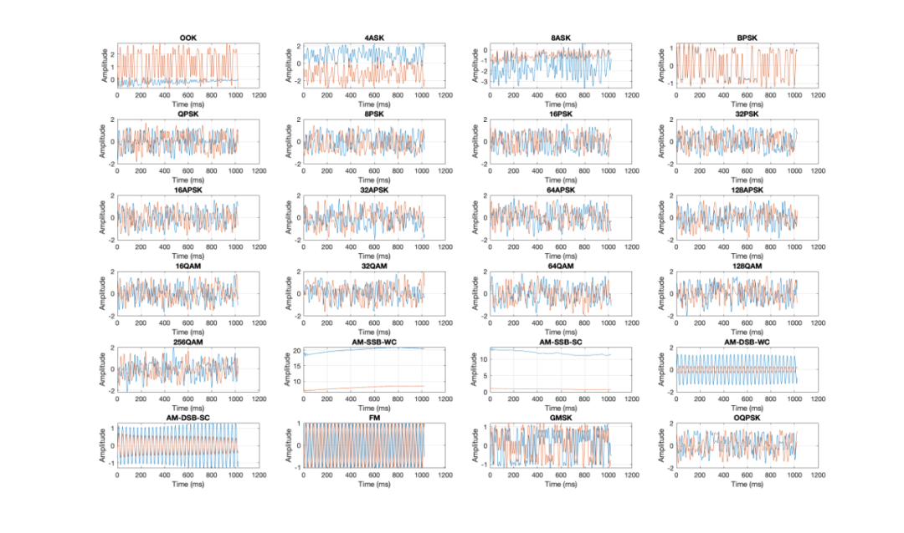
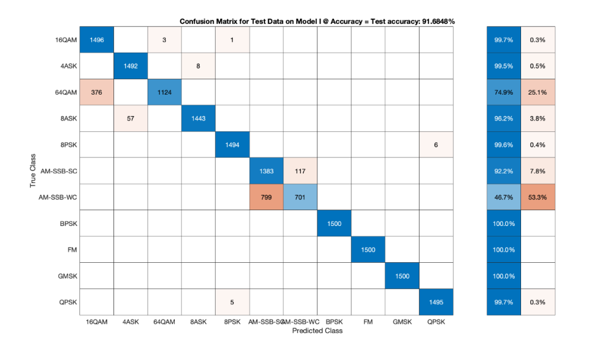
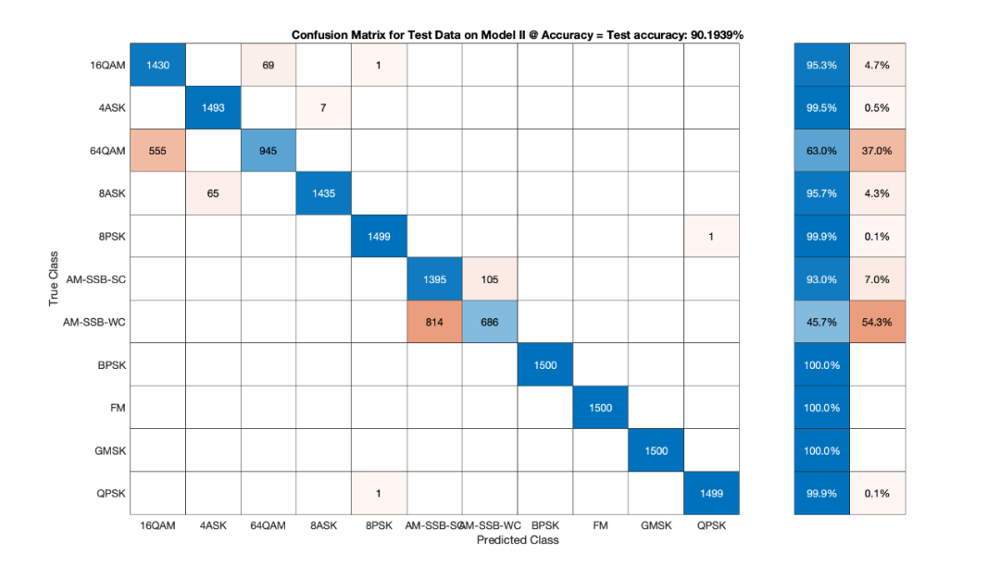

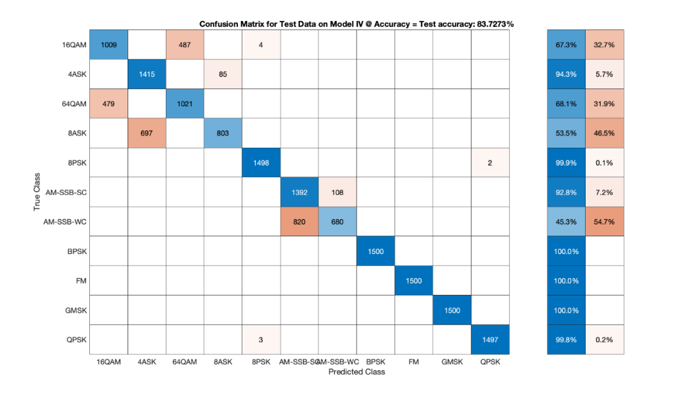

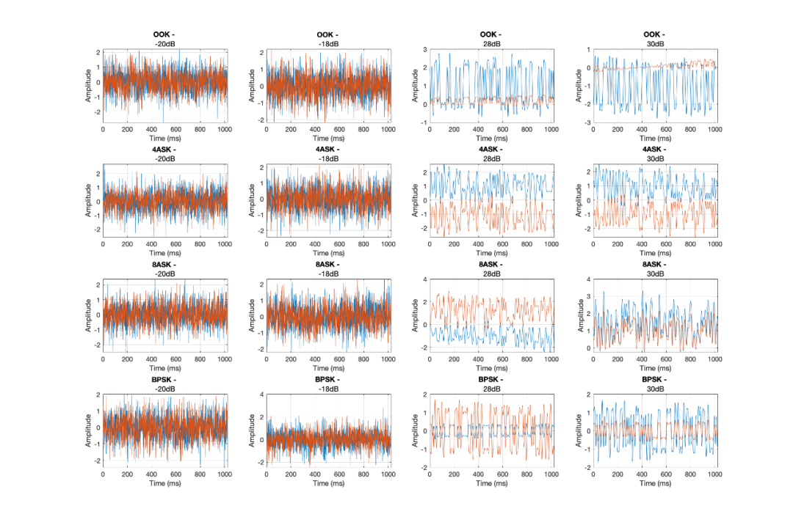
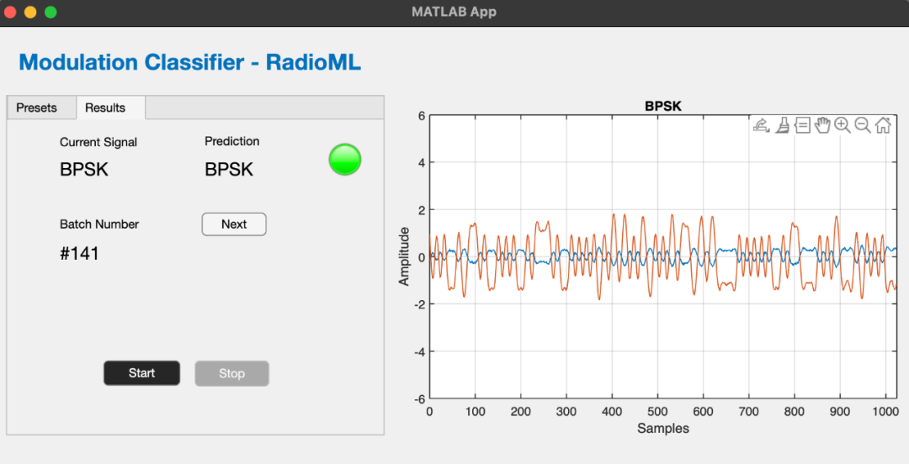
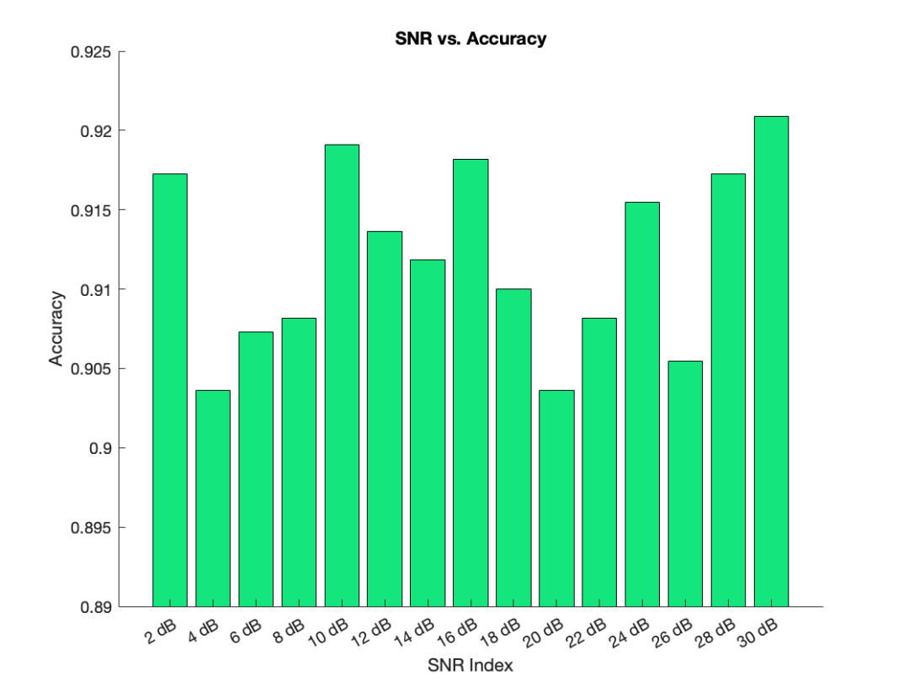
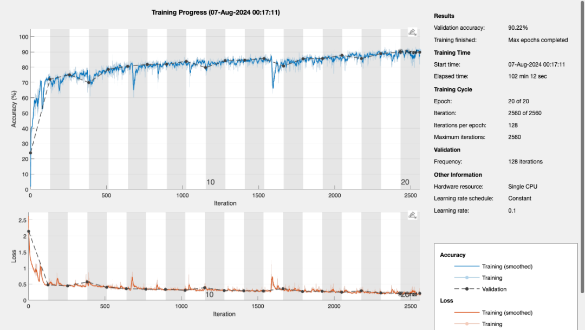
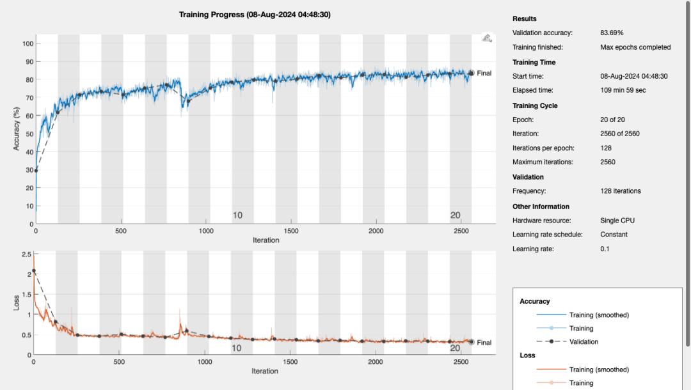
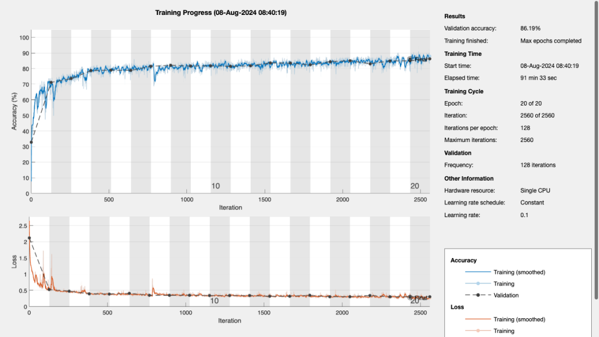
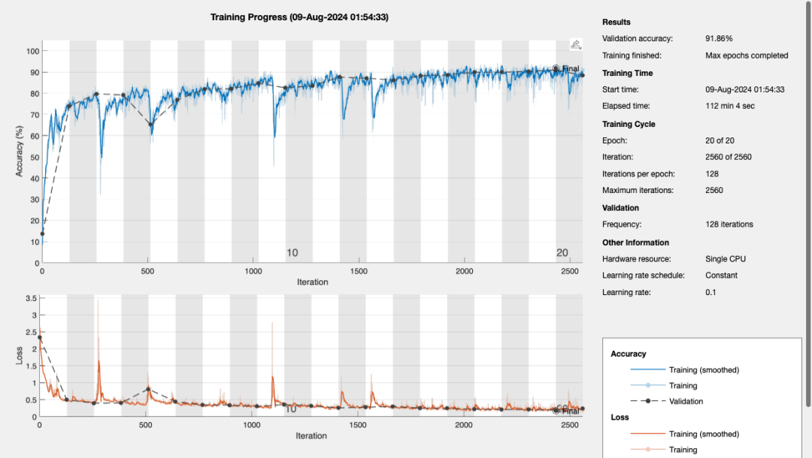

<!-- PAYMENT_BLOCK -->

## Get this dataset

- Payment link (Stripe): [Buy now](https://buy.stripe.com/3cs8yP7sY87d0vu9AB)
- Payment QR code: 

<!-- /PAYMENT_BLOCK -->
